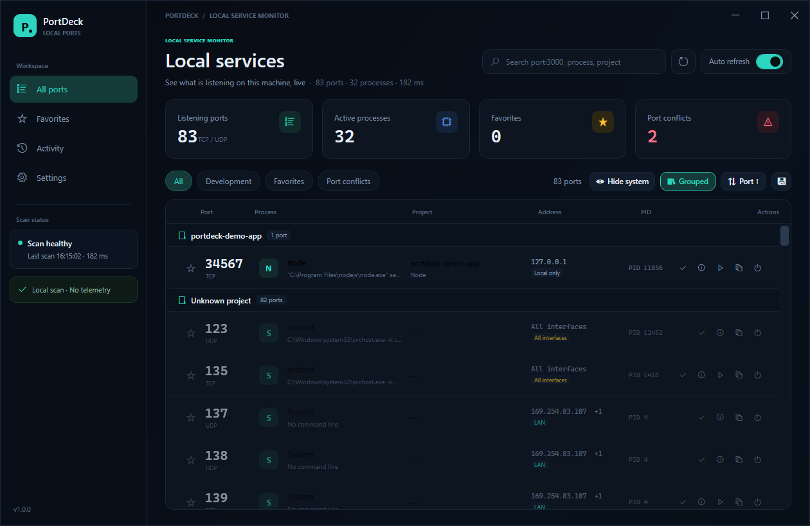

<p align="center">
  
</p>

<h1 align="center">PortDeck</h1>

<p align="center">
  <strong>See every local service running on Windows at a glance.</strong><br />
  Ports, processes, projects, and network exposure in one clean dashboard.
</p>

<p align="center">
  <strong>English</strong> · <a href="README.md">简体中文</a>
</p>

<p align="center">
  <a href="../../releases"></a>
  
  
  
</p>



## Why PortDeck

A typical dev machine has Vite, Next.js, a Python API, Docker, and a few background services running at the same time. Finding out which process owns a port usually means jumping between Task Manager, `netstat`, and a terminal.

PortDeck turns that into one local dashboard:

- **Live TCP / UDP listener list** with PID, process name, command line, and start time.
- **TCP / HTTP health checks** with reachability, latency, and HTTP status codes for common web ports and Node projects.
- **Activity log** of listener up/down events, with tray notifications for favorited ports.
- **Project detection** using the process working directory (read from the PEB) plus command-line paths. Relative commands such as `node server.js` work, and Node projects show the `name` from `package.json`.
- **Group by project** to see which ports belong together, with unknown processes collected at the end.
- **Exposure labels** for local-only, LAN, all interfaces, and public addresses.
- **Development filter** for common dev ports and Node, Python, Go, Java, and other runtimes.
- **Favorites and search**: search with `port:3000`, `pid:1234`, `project:demo`, `process:node`, `cwd:path`, and `addr:127.0.0.1`.
- **Detail drawer** with the full command line, working directory, open-in-browser, copy address, copy JSON, open a terminal in the working directory, and kill process tree. Critical Windows processes are protected.
- **Export and sorting**: export the current list as JSON or CSV, and sort by port, process, or project.
- **Simplified Chinese / English UI** with a live language switch and a system-language option.
- **Remembered preferences**: window position and size, maximized state, refresh interval, auto-refresh, system-process visibility, sorting, grouping, and language are stored locally.
- **Single instance**: launching PortDeck again activates the existing window instead of showing a “already running” message box.
- **Tray support**: optionally minimize to the tray on close and keep scanning in the background.
- **Docker / WSL mapping** of published container ports and running WSL listeners.
- **Automatic updates** against GitHub Releases: download, SHA256 verification, exe replacement, and restart.
- **Diagnostic logs** under `%LOCALAPPDATA%\PortDeck\logs`, with a shortcut in Settings.
- **Local-first**: no telemetry, no remote assets, no network requests.


## Download

Download `PortDeck-1.0.0-win-x64.exe` from [Releases](../../releases). It is a self-contained single-file executable and does not require a separate .NET runtime. ARM64 is built separately by CI. See [the v1.0.0 release notes](docs/RELEASE_NOTES_v1.0.0.md).

> The release workflow is wired to SignPath Foundation for open-source code signing. If SignPath is not configured yet, SmartScreen may show “Unknown publisher”; choose **More info → Run anyway**. See [docs/CODE_SIGNING.md](docs/CODE_SIGNING.md).

## Code signing policy

**Free code signing provided by [SignPath.io](https://about.signpath.io), certificate by [SignPath Foundation](https://signpath.org).**

Signing applies only to the Windows x64 / ARM64 executables built from this
repository by GitHub Actions. Maintainers review pull requests; the repository
owner approves each signing request manually. See
[CODE_SIGNING_POLICY.md](CODE_SIGNING_POLICY.md) for the full policy and
[PRIVACY.md](PRIVACY.md) for the privacy policy.

PortDeck is a local development dashboard, not a vulnerability scanner. It
does not probe remote hosts or report exploitable vulnerabilities.

## Usage

| Action | Description |
| --- | --- |
| `F5` | Rescan now |
| `Ctrl + F` | Focus the search box |
| `Esc` | Close the detail drawer or kill confirmation |
| Click a port row | Open details |
| Click the star | Add or remove a favorite |
| Click **Group by project** | Toggle grouped and flat lists |
| Click the sort button | Cycle port / process / project sorting |
| `Enter` | Open details for the selected port |
| Click the export button | Export the filtered list as JSON or CSV |
| Click the power icon | Kill the process tree after confirmation (critical processes are blocked) |

Preferences are stored locally:

```text
%APPDATA%\PortDeck\favorites.json
%APPDATA%\PortDeck\settings.json
```

## Build from source

Requirements:

- Windows 10 1809+ (x64)
- [.NET 10 SDK](https://dotnet.microsoft.com/download)

```powershell
git clone https://github.com/forrest-wang01/portdeck.git
cd portdeck

dotnet build
dotnet run

# Publish a self-contained single-file exe
dotnet publish -c Release -r win-x64 --self-contained true `
  -p:PublishSingleFile=true `
  -p:EnableCompressionInSingleFile=true `
  -o dist
```

The output is `dist\PortDeck.exe`, a self-contained single file of roughly 70 MB.

## How it works

1. Read the TCP listener table and owning PIDs with the Windows IP Helper API (`GetExtendedTcpTable`).
2. Read process metadata from WMI (`Win32_Process`).
3. Read the process working directory from its PEB with `NtQueryInformationProcess`.
4. Walk up from the working directory and command-line paths looking for project markers; for Node projects, read the `name` from `package.json`.
5. Everything runs locally. No port, process, or command-line data leaves the machine.

### Known limitations

- HTTP health checks request `/` and read the status code; specific APIs and WebSockets are not probed.
- UDP listeners cannot be health-checked.
- Docker mapping requires the `docker` CLI and a running daemon; otherwise it is skipped.
- Protected processes may hide their command line or working directory; those fields show `—`.
- Project detection is heuristic. Services started outside their project root, or processes whose working directory cannot be read, may not be associated with a project.
- “Open service” uses `http://` by default and `https://` for ports 443 and 8443.
- Killing system or elevated processes may require running PortDeck as administrator.
- Release builds are x64-first; ARM64 is built by CI but has not been tested on physical ARM hardware.
- Automatic updates require a writable install directory and the packaged `PortDeck.exe`.

## Local smoke test

The repository includes a tiny fixture:

```powershell
Push-Location tests\fixtures\demo-app
node server.js 34567
Pop-Location
```

The relative `server.js` path exercises working-directory detection. Open PortDeck and press `F5`; the service should appear under **Development**, grouped as project `portdeck-demo-app`.

You can also dump the current scan as JSON:

```powershell
.\dist\PortDeck.exe --dump-ports .\scan.json
```

## Release process

Releases are tag-driven:

```powershell
git tag v1.0.0
git push origin v1.0.0
```

`.github/workflows/release.yml` builds versioned x64 and ARM64 executables, generates SHA256 files, optionally signs both binaries, and publishes a GitHub Release.

Signing setup is documented in [docs/CODE_SIGNING.md](docs/CODE_SIGNING.md); winget / Scoop packaging is documented in [docs/PACKAGING.md](docs/PACKAGING.md).

## Roadmap

- [x] UDP listeners
- [x] Docker port mapping
- [x] WSL port mapping (best effort)
- [x] Port history and up/down notifications
- [ ] Custom port labels and groups
- [x] TCP health checks
- [x] HTTP status-code health checks
- [ ] Start with Windows
- [x] Automatic updates (download, verify, replace, restart)
- [x] Chinese/English, TCP/UDP, history, Docker/WSL, logging, ARM64, package generator
- [x] ARM64 build (CI)
- [ ] macOS / Linux versions

Issues and feature requests are welcome.

## Contributing

See [CONTRIBUTING.md](CONTRIBUTING.md). Before opening a pull request, make sure:

```powershell
dotnet build -c Release
```

passes. Run the automated tests with:

```powershell
dotnet test tests\PortDeck.Tests\PortDeck.Tests.csproj -c Release
```

Then manually verify scanning, the detail drawer, and the kill flow. When adding UI copy, update both `Localization/Strings.zh-CN.json` and `Localization/Strings.en-US.json`.

## License

[MIT](LICENSE) © 2026 PortDeck contributors

> `RepositoryUrl` is configured for `https://github.com/forrest-wang01/portdeck`, which update checks use. If you fork the project, update that URL.
