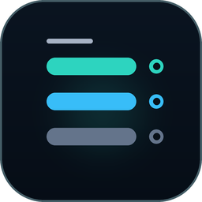
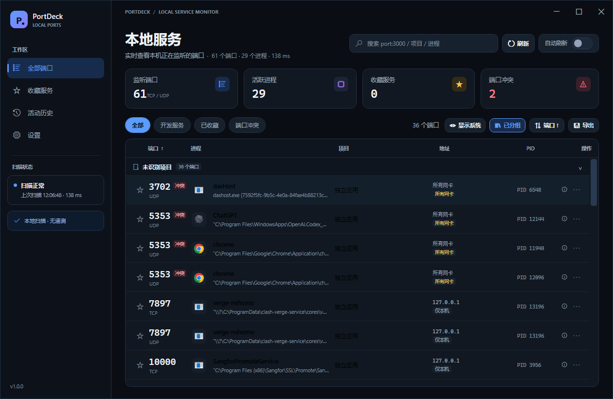
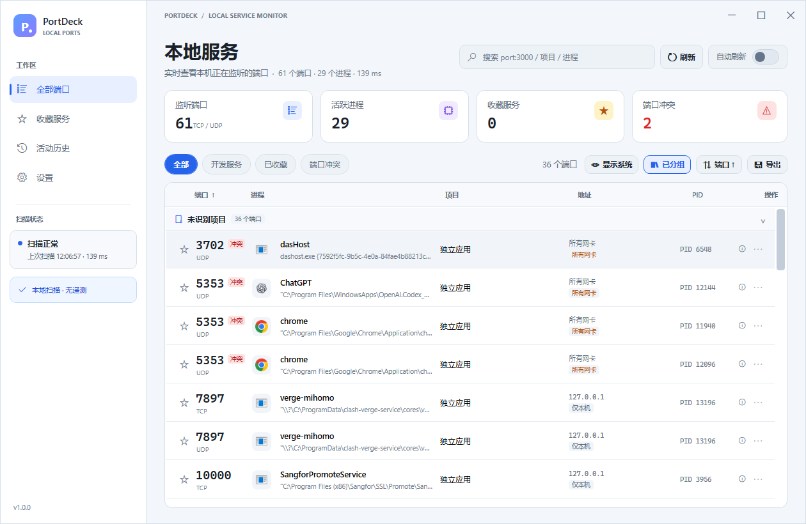
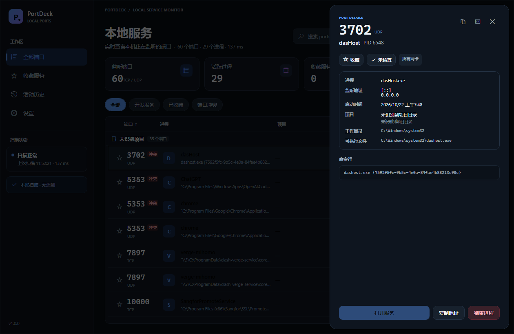
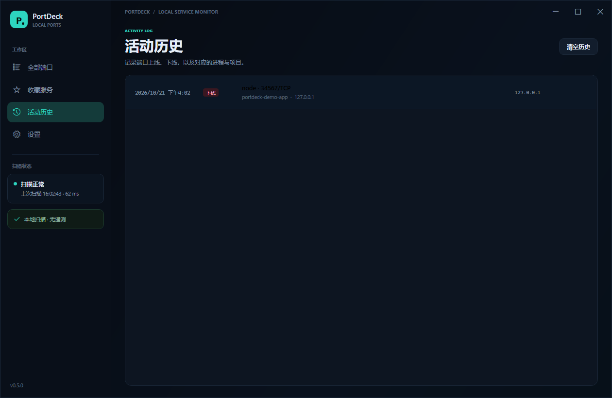

<p align="center">
  
</p>

<h1 align="center">PortDeck</h1>

<p align="center">
  <strong>一眼看清 Windows 上正在运行的本地服务。</strong><br />
  端口、进程、项目、暴露范围，一个窗口全部搞定。
</p>

<p align="center">
  <a href="README.en.md">English</a> · <strong>简体中文</strong>
</p>

<p align="center">
  <a href="../../releases"></a>
  
  
  
</p>



## 为什么做 PortDeck

开发时经常同时开着 Vite、Next.js、Python、Docker 和几个后台服务。想确认某个端口是谁占的，通常要在任务管理器、`netstat` 和终端之间来回切换。

PortDeck 把这件事变成一个清爽的本地仪表盘：

- **实时端口列表**：TCP / UDP 监听端口、PID、进程名、命令行、启动时间。
- **TCP / HTTP 健康检查**：点击心跳按钮即可检测端口是否可连接，并显示延迟；常见 Web 端口和 Node 项目会额外显示 HTTP 状态码。
- **活动历史**：记录端口上线/下线事件，收藏端口发生变化时发送托盘通知。
- **项目识别**：读取进程工作目录（PEB），结合命令行向上查找 `package.json`、`pyproject.toml`、`go.mod`、`Cargo.toml` 等标记。`node server.js` 这种相对路径也能识别，Node 项目会显示 `package.json` 里的包名。
- **按项目分组**：一键把端口按项目归类，项目在前，未识别项目收在最后。
- **暴露范围提示**：区分「仅本机」「局域网」「所有网卡」「公网」，避免把开发服务意外暴露到局域网。
- **开发服务筛选**：快速过滤常见开发端口和 Node、Python、Go、Java 等运行时。
- **中英双语**：设置中可切换简体中文 / English / 跟随系统，立即生效。
- **收藏与搜索**：按端口收藏常用服务；支持 `port:3000`、`pid:1234`、`project:demo`、`process:node`、`cwd:path`、`addr:127.0.0.1` 搜索语法。
- **详情与操作**：查看完整命令行、工作目录，一键打开浏览器、复制地址、复制 JSON、在工作目录打开终端、结束进程树；系统关键进程会被保护。
- **导出与排序**：当前列表可导出 JSON/CSV，可按端口、进程或项目排序。
- **记住你的习惯**：窗口位置/大小、最大化、刷新间隔、自动刷新、系统进程显示、排序、分组和语言都会保存在本机。
- **单实例**：重复启动会直接唤起已经运行的窗口，而不是弹一个“已在运行”的提示框。
- **托盘常驻**：可以设置关闭窗口时最小化到托盘，扫描在后台继续。
- **Docker / WSL 映射**：如果本机运行 Docker 或 WSL，详情中会显示端口对应的容器 / 发行版监听进程。
- **自动更新**：可在设置中开启启动检查；发现新版本后可下载、校验 SHA256、替换当前 exe 并重启。
- **日志诊断**：扫描异常写入 `%LOCALAPPDATA%\PortDeck\logs`，设置里可一键打开。
- **外观**：深色 / 浅色主题、100% / 125% 缩放、可拖拽列宽、表头排序、行右键菜单。
- **真实进程图标**：读取 exe 内嵌图标，无法读取时使用统一占位符。
- **表格交互**：列宽可拖动并记忆、表头排序、项目分组可折叠、搜索命中高亮、行操作收进“…”菜单。
- **完全本地**：不联网、不加载远程资源、无遥测。







## 下载

从 [Releases](../../releases) 下载 `PortDeck-1.0.0-win-x64.exe`，双击运行即可，不需要安装 .NET 运行时。ARM64 构建由 CI 单独产出。发布说明见 [docs/RELEASE_NOTES_v1.0.0.md](docs/RELEASE_NOTES_v1.0.0.md)。

> Release 工作流已接入 SignPath Foundation 开源代码签名。如果维护者还没有配置 SignPath，Windows SmartScreen 可能提示「未知发布者」，选择「更多信息」→「仍要运行」即可。配置步骤见 [docs/CODE_SIGNING.md](docs/CODE_SIGNING.md)。

## Code signing policy

**Free code signing provided by [SignPath.io](https://about.signpath.io), certificate by [SignPath Foundation](https://signpath.org).**

Signing applies only to the Windows x64 / ARM64 executables built from this
repository by GitHub Actions. Maintainers review pull requests; the repository
owner approves each signing request manually. See
[CODE_SIGNING_POLICY.md](CODE_SIGNING_POLICY.md) for the full policy and
[PRIVACY.md](PRIVACY.md) for the privacy policy.

PortDeck is a local development dashboard, not a vulnerability scanner. It
does not probe remote hosts or report exploitable vulnerabilities.

## 使用

| 操作 | 说明 |
| --- | --- |
| `F5` | 立即重新扫描 |
| `Ctrl + F` | 聚焦搜索框 |
| `Esc` | 关闭详情抽屉 / 结束进程确认框 |
| 点击端口行 | 打开详情 |
| 点击星标 | 收藏 / 取消收藏 |
| 点击「按项目」 | 在项目分组和平铺列表之间切换 |
| 点击排序按钮 | 在端口 / 进程 / 项目排序之间循环 |
| `Enter` | 打开当前选中端口的详情 |
| 点击导出按钮 | 导出当前筛选结果为 JSON 或 CSV |
| 点击电源图标 | 结束该进程及其子进程（系统关键进程会被拦截） |

设置中可以调整自动刷新间隔、隐藏系统进程、关闭窗口时最小化到托盘、清空收藏。本地数据保存在：

```text
%APPDATA%\PortDeck\favorites.json
%APPDATA%\PortDeck\settings.json
```

## 从源码构建

环境要求：

- Windows 10 1809 或更高版本（x64）
- [.NET 10 SDK](https://dotnet.microsoft.com/download)

```powershell
git clone https://github.com/forrest-wang01/portdeck.git
cd portdeck

dotnet build
dotnet run

# 发布单文件 exe 到 dist/
dotnet publish -c Release -r win-x64 --self-contained true `
  -p:PublishSingleFile=true `
  -p:EnableCompressionInSingleFile=true `
  -o dist
```

产物是 `dist\PortDeck.exe`，自包含、单文件，约 70 MB。

## 工作原理

1. 通过 Windows IP Helper API（`GetExtendedTcpTable`）读取 TCP 监听表和 owning PID。
2. 通过 WMI（`Win32_Process`）读取进程名、可执行路径、命令行和启动时间。
3. 通过 `NtQueryInformationProcess` 读取目标进程 PEB 中的当前工作目录（CurrentDirectory）。
4. 结合工作目录和命令行路径，向上查找项目标记文件；Node 项目会读取 `package.json` 的 `name`。
5. 全部处理在本机完成，不发送任何数据。

### 已知限制

- HTTP 健康检查只请求 `/` 并读取状态码，不验证具体 API 或 WebSocket。
- UDP 端口无法做连接健康检查。
- Docker 映射依赖本机 `docker` CLI 和运行中的 daemon；没有 Docker 时会自动跳过。
- 部分受保护的系统进程无法读取命令行或工作目录，详情中会显示 `—`。
- 项目识别是启发式的：在项目根目录之外启动、或工作目录被拒绝访问时，可能识别不到项目。
- 「打开服务」默认使用 `http://`；443 / 8443 端口会使用 `https://`。
- 结束系统进程或高权限进程可能需要以管理员身份运行 PortDeck。
- 本地发布以 Windows x64 为主；ARM64 由 CI 单独构建，尚未做真机验证。
- 自动更新要求 PortDeck 所在目录可写，且只能更新打包后的 `PortDeck.exe`。

## 本地测试

仓库里带了一个最小的测试服务：

```powershell
Push-Location tests\fixtures\demo-app
node server.js 34567
Pop-Location
```

`server.js` 是相对路径，正好用来验证工作目录识别。然后在 PortDeck 中按 `F5`，应该能看到 `node` 在 `127.0.0.1:34567` 上监听，出现在「开发服务」筛选中，并归入项目 `portdeck-demo-app`。

隐藏的诊断模式可以把当前扫描结果写成 JSON，便于排查问题：

```powershell
.\dist\PortDeck.exe --dump-ports .\scan.json
```

## 发布新版本

发布由标签触发，不需要手动上传 exe：

```powershell
git tag v1.0.0
git push origin v1.0.0
```

`.github/workflows/release.yml` 会：

1. 用标签版本号构建 x64 / ARM64 自包含 exe；
2. 生成各自的 SHA256 校验文件；
3. 如果配置了签名 Secret，自动签名并验证；
4. 创建 GitHub Release 并上传产物。

签名配置见 [docs/CODE_SIGNING.md](docs/CODE_SIGNING.md)，winget / Scoop 打包步骤见 [docs/PACKAGING.md](docs/PACKAGING.md)。

## 路线图

- [x] UDP 端口
- [x] Docker 端口映射识别
- [x] WSL 端口映射识别（best-effort）
- [x] 端口历史与上下线通知
- [ ] 自定义端口标签与分组
- [x] TCP 健康检查
- [x] HTTP 状态码健康检查
- [ ] 开机自启
- [x] 自动更新（下载、校验、替换、重启）
- [x] 中英双语、TCP/UDP、历史、Docker/WSL、日志、ARM64、打包生成器
- [x] 英文界面与多语言
- [x] ARM64 构建（CI）
- [ ] macOS / Linux 版本

欢迎在 Issues 中投票或补充需求。

## 贡献

见 [CONTRIBUTING.md](CONTRIBUTING.md)。提交前请确保：

```powershell
dotnet build -c Release
```

可以通过。自动化测试：

```powershell
dotnet test tests\PortDeck.Tests\PortDeck.Tests.csproj -c Release
```

然后再手动验证端口扫描、详情和结束进程流程。新增界面文案时，请同时更新
`Localization/Strings.zh-CN.json` 和 `Localization/Strings.en-US.json`。

## License

[MIT](LICENSE) © 2026 PortDeck contributors

> 本仓库的 `RepositoryUrl` 已配置为 `https://github.com/forrest-wang01/portdeck`，更新检查会读取它。如果你 fork 到其他账号，请同步修改该地址。
